# ERP-IMS — Institute Management System
## System Architecture, End-to-End Application Flows & Project Structure Guide

> **Document Version:** 2.0 (Comprehensive Architectural Reference)  
> **Target Framework:** .NET 8.0 (C# 12) | ASP.NET Core MVC  
> **Database:** Microsoft SQL Server (Transact-SQL / Stored Procedures / Raw ADO.NET)  
> **Identity & Access Management:** Keycloak (OIDC / JWT) + Custom Cookie Auth for Student/Guardian Portal  
> **Cache & Session Store:** Redis (StackExchange.Redis) + In-Memory Caching (`IMemoryCache`)  
> **Last Updated:** November 2026

---

## Table of Contents

1. [Executive Summary & System Purpose](#1-executive-summary--system-purpose)
2. [High-Level System Architecture](#2-high-level-system-architecture)
3. [Technology Stack](#3-technology-stack)
4. [Solution Architecture & Layer Breakdown](#4-solution-architecture--layer-breakdown)
   - [4.1 Presentation Layer (`IMS.Web`)](#41-presentation-layer-imsweb)
   - [4.2 Service Layer (`IMS.Services`)](#42-service-layer-imsservices)
   - [4.3 Data Access Layer (`IMS.DAL`)](#43-data-access-layer-imsdal)
   - [4.4 Domain & Shared Models (`IMS.Models`)](#44-domain--shared-models-imsmodels)
   - [4.5 Cross-Cutting Helpers & Options (`IMS.Helpers`)](#45-cross-cutting-helpers--options-imshelpers)
5. [Multi-Tenancy Architecture & Data Isolation](#5-multi-tenancy-architecture--data-isolation)
6. [Security, Authentication & Authorization Engine](#6-security-authentication--authorization-engine)
   - [6.1 Dual Authentication Scheme (Admin/Staff vs Student/Guardian)](#61-dual-authentication-scheme)
   - [6.2 Keycloak OpenID Connect & Silent Token Refresh](#62-keycloak-openid-connect--silent-token-refresh)
   - [6.3 Redis Caching & RBAC Permission Evaluation](#63-redis-caching--rbac-permission-evaluation)
   - [6.4 Startup Permission Synchronization](#64-startup-permission-synchronization)
7. [End-to-End Application & Business Flows](#7-end-to-end-application--business-flows)
   - [7.1 Flow 1: Admission to Enrollment Lifecycle](#71-flow-1-admission-to-enrollment-lifecycle)
   - [7.2 Flow 2: Academic Progression & Student Promotion](#72-flow-2-academic-progression--student-promotion)
   - [7.3 Flow 3: Curriculum Delivery, Batches & Timetables](#73-flow-3-curriculum-delivery-batches--timetables)
   - [7.4 Flow 4: Daily Operations (Attendance & Leave Management)](#74-flow-4-daily-operations-attendance--leave-management)
   - [7.5 Flow 5: Examination Lifecycle, Grading & Digital Results](#75-flow-5-examination-lifecycle-grading--digital-results)
   - [7.6 Flow 6: Institutional Finance & Fee Collection Engine](#76-flow-6-institutional-finance--fee-collection-engine)
   - [7.7 Flow 7: Student & Guardian Self-Service Portal](#77-flow-7-student--guardian-self-service-portal)
   - [7.8 Flow 8: Metadata-Driven Master Data Engine (Zero-Code CRUD)](#78-flow-8-metadata-driven-master-data-engine)
   - [7.9 Flow 9: Dynamic Database-Driven Sidebar Navigation](#79-flow-9-dynamic-database-driven-sidebar-navigation)
   - [7.10 Flow 10: Institutional Data Backup & Notification Hub](#710-flow-10-institutional-data-backup--notification-hub)
8. [Complete Project & Directory Structure](#8-complete-project--directory-structure)
9. [Database Architecture & Design Patterns](#9-database-architecture--design-patterns)
   - [9.1 Table Naming & Suffix Standards](#91-table-naming--suffix-standards)
   - [9.2 Common Columns & Audit Tracking](#92-common-columns--audit-tracking)
   - [9.3 Stored Procedure Patterns & Action Verbs](#93-stored-procedure-patterns--action-verbs)
   - [9.4 Table-Valued Parameters (TVPs) & Transactions](#94-table-valued-parameters-tvps--transactions)
10. [Architectural Highlights & Best Practices](#10-architectural-highlights--best-practices)

---

## 1. Executive Summary & System Purpose

**ERP-IMS** (Enterprise Resource Planning — Institute Management System) is an enterprise-grade, multi-tenant academic and institutional management platform. Built to serve educational organizations ranging from single-campus schools to multi-branch collegiate systems, ERP-IMS centralizes:

- **Admissions & Student Lifecycle:** Public lead generation, application tracking, document verification, academic allocation, promotion across grades, and transfer certificates.
- **Academic Delivery & Scheduling:** Multi-level academic hierarchy (Year > Branch > Department > Classroom > Program > Course > Subject), batch allocations, curriculum syllabus tracking, timetable clash prevention, home tasks, and mock assessments.
- **Human Resources & Faculty:** Staff and teacher profiles, daily teacher biometric/manual attendance, teacher leaves, and centralized faculty directories.
- **Examinations & Evaluation:** Exam creation, scheduling, room invigilation, marks entry, automated grading scales, and digital report card generation.
- **Institutional Finance:** Dynamic fee structures, multi-installment invoicing, real-time counter collection desks with payment receipts, ad-hoc charges, student fee ledgers, daily collection scrolls, and institutional expenses.
- **Student & Guardian Portal:** Dedicated self-service portal area supporting multi-ward guardian linking, active ward switching, digital ID cards, fee transaction histories, and leave/TC applications.
- **Dynamic Extensibility:** Metadata-driven Master Management engine (zero boilerplate CRUD for lookup tables) and database-driven sidebar navigation configurable without code redeployment.

---

## 2. High-Level System Architecture

The system is architected as a layered Clean/Onion Architecture with clear physical boundaries, distributed caching, external identity federation, and a high-performance raw ADO.NET data access layer.

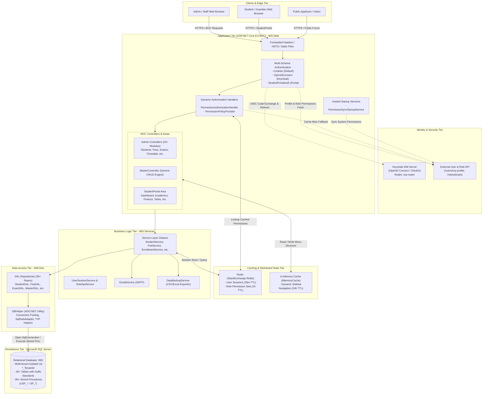

---

## 3. Technology Stack

| Layer / Concern | Technology / Component | Version / Specification | Rationale & Responsibility |
|---|---|---|---|
| **Framework** | .NET (C#) | `net8.0` / C# 12 | High-performance runtime, modern language features, cross-platform compatibility. |
| **Web Presentation** | ASP.NET Core MVC | 8.0.x | Server-rendered Razor views, TagHelpers, custom action filters, localized areas. |
| **Frontend UI** | HTML5, CSS3, Bootstrap 5, FontAwesome 6, jQuery | Modern Responsive | Lightweight client script, AJAX modals, responsive layouts, data tables. |
| **Data Access** | Raw ADO.NET (`System.Data.SqlClient`) | 4.9.1 | Deliberate avoidance of Entity Framework Core to eliminate ORM overhead; maximum performance via compiled Stored Procedures and Table-Valued Parameters (TVPs). |
| **Relational Database** | Microsoft SQL Server | 2019 / 2022 / LocalDB | Enterprise ACID transactions, indexed views, schemas, and stored procedures with strict tenant isolation. |
| **Authentication (Admin/Staff)** | Keycloak OpenID Connect | Keycloak 24+ / OIDC standard | Centralized single sign-on (SSO), JWT token validation, silent refresh-token cycle. |
| **Authentication (Student Portal)** | ASP.NET Core Cookie Auth | Scheme: `StudentPortalAuth` | Isolated session cookie for students/guardians with 7-day sliding expiration and multi-ward switching. |
| **Distributed Caching** | Redis (`StackExchange.Redis`) | 3.0.11 | Sub-millisecond user session storage, role permission sets, tenant profiles. |
| **Local Memory Cache** | `Microsoft.Extensions.Caching.Memory` | 8.0.1 | 24-hour cache for the database-driven sidebar menu and static lookups. |
| **External Integration** | `HttpClientFactory` & System API | REST / JSON | Dynamic sync of application permission catalogs and external user profile fetching. |
| **Email Services** | System.Net.Mail / Custom SMTP | HTML Mailers | Admission receipts, approval notices, fee receipts, and portal login credentials. |
| **Document Export** | Custom Data Backup Engine | CSV / TSV / Stream | Full institutional data backups and module-level data exports with tenant filtering. |

---

## 4. Solution Architecture & Layer Breakdown

The solution `erp-ims.sln` is organized into five tightly scoped projects adhering to the Separation of Concerns (SoC) principle:

```
erp-ims.sln
├── IMS.Web          (Presentation Layer: Web UI, Controllers, Areas, Auth, Extensions)
├── IMS.Services     (Business Logic Layer: Domain Services, External API Clients, Email)
├── IMS.DAL          (Data Access Layer: Raw ADO.NET, Repositories, Stored Proc Invokers)
├── IMS.Models       (Shared Domain Models, ViewModels, Registries, DTOs)
└── IMS.Helpers      (Cross-Cutting Constants, RBAC Permissions, Options)
```

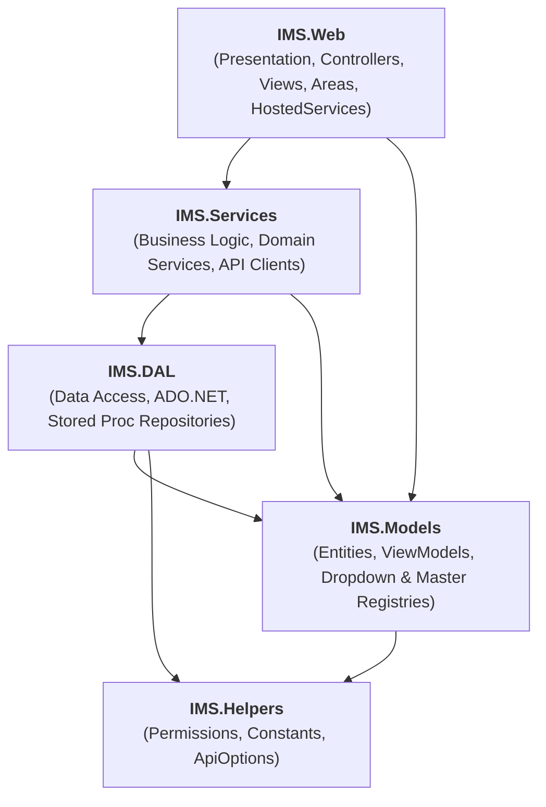

---

### 4.1 Presentation Layer (`IMS.Web`)

The web project acts as the user interface and HTTP edge.
- **Entry Point (`Program.cs`):**
  - Connects to Redis via `ConnectionMultiplexer`.
  - Binds strongly-typed configuration (`ApiOptions`).
  - Registers DAL services via extension `AddIMSDataAccess()`.
  - Registers Business services via extension `AddIMSBusinessServices()`.
  - Configures Keycloak OIDC and Dual-cookie Authentication via `AddKeycloakAuth()`.
  - Sets up the custom authorization policy provider via `AddPermissionAuthorization()`.
  - Starts the background hosted service `PermissionSyncStartupService`.
  - Configures HTTP middleware pipeline: Forwarded Headers, Exception Handling, Static Files, Routing, Authentication, Authorization, and Route mapping.
- **Controllers (`IMS.Web/Controllers/`):** 27 MVC controllers managing admin workflows:
  - `StudentsController`, `AdmissionApplicationController`, `EnrollmentController`, `BatchController`, `CourseSubjectController`, `SyllabusController`, `TimetableController`, `HomeTasksController`, `MockTestsController`.
  - `TeachersController`, `TeacherAttendanceController`, `TeacherLeaveController`, `StaffController`.
  - `AttendanceController`, `ExamController`, `FeesController`, `ExpenseController`.
  - `MasterController` (generic metadata-driven CRUD handler).
  - `DropdownController` (generic cascading dropdown provider).
  - `SidebarMenuController` (UI navigation configuration).
  - `NotificationConfigController` & `DataBackupController`.
- **Student Portal Area (`IMS.Web/Areas/StudentPortal/`):**
  - Fully segregated portal for students and parents under route prefix `/StudentPortal/`.
  - `StudentPortalBaseController`: Extracts claims (`CurrentUserId`, `CurrentTenantId`, `LinkedStudents`), verifies ward access, and injects active student contexts into `ViewBag`.
  - Dedicated controllers: `AuthController`, `DashboardController`, `AcademicsController`, `ExamsController`, `FinanceController`, `RequestsController`, `TasksController`.
- **Authorization Infrastructure (`IMS.Web/Authorization/`):**
  - `[Permission(Permissions.X)]`: Custom declarative attribute for controller actions.
  - `PermissionPolicyProvider`: Dynamically turns permission strings into authorization policies at runtime.
  - `PermissionAuthorizationHandler`: Multi-layered authorization check evaluating admin bypass, Redis cache, and external Role API fallbacks.
- **Hosted Startup Services (`IMS.Web/HostedServices/`):**
  - `PermissionSyncStartupService`: Runs at application boot with exponential backoff (5 retries, 5s delay) to push all internal permission definitions to the central IAM API.

---

### 4.2 Service Layer (`IMS.Services`)

Encapsulates all business rules, calculations, cross-repository orchestrations, and external communications.
- **Domain Services:**
  - `StudentService`: Manages student profiles, guardian links, quick updates, and filters.
  - `AdmissionApplicationService`: Oversees public submissions, document processing, review workflows, fee structure offers, and enrollment conversions.
  - `EnrollmentService`: Manages batch allocations, student enrollment records, and year-end student promotion across classes.
  - `FeeService`: Complex billing engine for batch invoice generation, quick charges, counter payment collections, student fee ledgers, daily collection scrolls, and receipt generation.
  - `AttendanceService` & `TeacherAttendanceService`: Handles student session attendance and daily teacher clock-in/out records.
  - `ExamService`: Exam definitions, schedules, subject-wise marks entry, and GPA/grade calculation.
  - `TimetableService`: Period grids, teacher-subject-classroom assignments, and scheduling validation.
  - `SubjectSyllabusService`: Term-wise syllabus completion tracking and lesson units.
  - `HomeTaskService` & `MockTestService`: Assignment distribution, file uploads, online mock assessments.
  - `TransferCertificateService` & `StudentLeaveService`: Request verification, administrative clearance, and approval lifecycles.
  - `SidebarMenuService`: Fetches, structures, and caches navigation trees with `IMemoryCache`.
  - `DataBackupService`: Institutional data extraction and CSV serialization.
- **Infrastructure Services:**
  - `RedisService`: Typed Redis operations (`HashGet`, `HashSet`, `SetAdd`, `SetMembers`, `StringGet/Set`).
  - `UserSessionService`: Parses Keycloak claims, queries `UserApiService`, enriches claims, and caches sessions in Redis.
  - `UserApiService` & `RoleApiService`: REST client wrappers for the external system API.
  - `PermissionSyncService`: Scans `Permissions.All` and pushes updates to `/system/permissions/sync`.
  - `EmailService`: HTML template formatting and SMTP dispatch.

---

### 4.3 Data Access Layer (`IMS.DAL`)

A zero-ORM, ultra-fast data access layer utilizing compiled Stored Procedures and ADO.NET.
- **`DBHelper` (`IMS.DAL/Common/DBHelper.cs`):**
  - Manages raw `SqlConnection` lifecycles and connection pooling.
  - `ExecuteStoredProcedure`: Fills and returns disconnected `DataTable` results.
  - `ExecuteStoredProcedureScalar`: Retrieves single values (e.g. existence checks, counts).
  - `ExecuteStoredProcedureNonQuery`: Executes inserts, updates, deletes, returning rows affected.
  - `ExecuteStoredProcedureWithOutput`: Captures SQL `OUTPUT` parameters (such as newly generated `UNIQUEIDENTIFIER` GUIDs).
  - `TableParam`: Binds .NET `DataTable` objects to SQL Server Table-Valued Parameters (TVPs) using `SqlDbType.Structured`.
  - `UnwrapValue`: Safely converts JSON elements, nullable primitives, and GUIDs to database types or `DBNull.Value`.
- **Repositories (30+ Data Access Classes):**
  - Follow the unified naming pattern `*DAL.cs` implementing explicit interfaces in `IMS.DAL/Interfaces/`.
  - Dispatches calls to stored procedures (`USP_*` and `SP_*`) passing structured parameter dictionaries.

---

### 4.4 Domain & Shared Models (`IMS.Models`)

Houses all shared models, avoiding circular dependencies between web, service, and DAL layers.
- **Domain Entities:** Strongly typed representations of database tables (e.g. `Student`, `Guardian`, `Enrollment`, `FeeStructure`, `FeeInvoice`, `Payment`, `Exam`, `AttendanceSession`, `Timetable`).
- **ViewModels:** Specialized ViewModels for form submissions, filtering, pagination, and data grids:
  - Form models: `StudentFormViewModel`, `EnrollmentFormViewModel`, `FeeStructureFormViewModel`, `PaymentFormViewModel`.
  - Paged list containers: `StudentListViewModel`, `EnrollmentListViewModel`, `FeeInvoiceListViewModel`.
  - Special composite models: `StudentPromotionRequestViewModel`, `FeeCollectSubmissionModel`, `StudentFeeLedgerViewModel`.
- **Portal ViewModels (`IMS.Models/Portal/`):** DTOs tailored for the self-service portal: `StudentDashboardDto`, `StudentProfileDto`, `StudentAttendanceSummaryDto`, `AdmitCardDto`, `MarkSheetDto`, `StudentFeeTransactionDto`.
- **Metadata Registries:**
  - `MasterConfigRegistry`: Declarative configuration defining metadata for 15+ master lookup entities (table names, key columns, display names, form fields, validation rules, icons, and permissions).
  - `DropdownConfigRegistry`: Declarative lookup rules for generic cascading dropdowns.
- **Navigation Models (`IMS.Models/Common/Navigation/`):** `SidebarMenuItemModel`, `NavSectionConfig`, `NavItemConfig`.

---

### 4.5 Cross-Cutting Helpers & Options (`IMS.Helpers`)

Contains constants, permission keys, and shared configuration options.
- **Permissions Catalog (`IMS.Helpers/Constants/Permissions.cs`):**
  - Central repository of all string permission constants categorized by domain (e.g., `ViewStudent`, `AddStudent`, `ViewFees`, `AddFees`, `ViewExam`, `ManageMaster`, `ViewSidebarMenu`).
  - Contains `Permissions.All`, exposing complete metadata (`Id`, `FeatureKey`, `FeatureDisplayName`, `Description`, `ServiceName`) for dynamic synchronization with IAM.
- **System Roles (`IMS.Helpers/Constants/AppRoles.cs`):** Defines `TenantAdmin`, `SYSTEM_ADMIN`, `Teacher`, `Staff`, `Student`, `Guardian`.
- **Configuration Options (`IMS.Helpers/Options/ApiOptions.cs`):** Strongly-typed options for upstream microservices (`UserApi` and `SystemApi` endpoints).
- **Teacher HR Options (`IMS.Helpers/Constants/TeacherHrOptions.cs`):** Static dropdown lists for employment types, qualifications, and blood groups.

---

## 5. Multi-Tenancy Architecture & Data Isolation

ERP-IMS is architected for strict logical multi-tenancy. Multiple educational institutions operate on a shared infrastructure with complete data segregation.

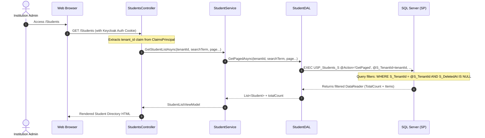

### Key Multi-Tenancy Rules
1. **Tenant Identification:**
   - Every tenant is assigned a globally unique `UNIQUEIDENTIFIER` (`TenantId`).
   - For administrative users, `TenantId` is embedded in the Keycloak JWT token claim `tenant_id`.
   - On token validation, `UserSessionService` maps this into the user's `ClaimsIdentity`.
   - In controllers, `CurrentTenantId` property extracts `User.FindFirst("tenant_id")?.Value`.
2. **Database Column Standard:**
   - Every tenant-scoped table in SQL Server includes a non-nullable column named `[Prefix]_TenantId` of type `UNIQUEIDENTIFIER`.
   - Foreign key and unique constraints are composite, scoped to the tenant (e.g., `UNIQUE(AY_TenantId, AY_Code)`).
3. **Data Access Enforcement:**
   - Every stored procedure requires `@TenantId` (or `@[Prefix]_TenantId`) as a mandatory parameter.
   - All `SELECT`, `UPDATE`, and `DELETE` queries strictly include `WHERE [Prefix]_TenantId = @TenantId`.
   - In the Student Portal, `TenantId` is baked into the student's portal cookie session, preventing cross-tenant leakage.

---

## 6. Security, Authentication & Authorization Engine

ERP-IMS uses a hybrid security architecture combining modern OpenID Connect federation with high-performance local cookie sessions and distributed caching.

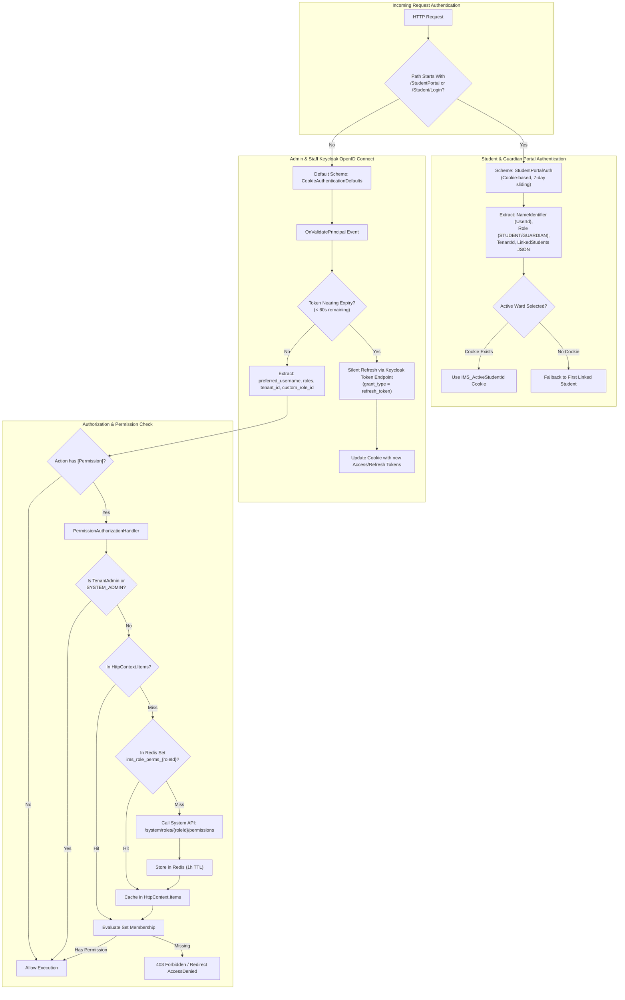

### 6.1 Dual Authentication Scheme
1. **Primary Admin / Staff Scheme:**
   - Default authentication scheme: Cookies (`CookieAuthenticationDefaults.AuthenticationScheme`).
   - Default challenge scheme: OpenID Connect (`OpenIdConnectDefaults.AuthenticationScheme`).
   - Managed via Keycloak identity server.
2. **Student & Guardian Portal Scheme:**
   - Independent cookie authentication scheme: `"StudentPortalAuth"` (and alias `"PortalAuth"`).
   - Login endpoint: `/Student/Login`.
   - Does not touch Keycloak; credentials (`Email`/`AdmissionNumber` + BCrypt/PBKDF2 Password Hash) are authenticated directly against `Students_S` and `Guardians_G` via stored procedure `SP_Portal_Authenticate`.
   - Allows parents with multiple enrolled children to switch between wards seamlessly via the `IMS_ActiveStudentId` cookie.

### 6.2 Keycloak OpenID Connect & Silent Token Refresh
- Keycloak Authority: `https://keycloak.fastteamdev.space/realms/erp-realm`
- Client ID: `erp-ims-client`
- Response Type: `code` (Authorization Code Flow with PKCE).
- Scope: `openid`, `profile`, `email`, `roles`.
- **Silent Background Refresh:**
  - Implemented in `KeycloakExtensions.TryRefreshTokenAsync` on `CookieAuthenticationEvents.OnValidatePrincipal`.
  - When token validity drops below 60 seconds, it silently calls Keycloak's token endpoint with `grant_type=refresh_token`.
  - Re-issues the updated authentication cookie without interrupting the user's workflow or forcing a redirect.

### 6.3 Redis Caching & RBAC Permission Evaluation
- **Session Storage:**
  - On login (`OnTokenValidated`), `UserSessionService.StoreUserSessionAsync` calls `UserApiService.GetMyProfileAsync`.
  - The complete user profile and assigned permissions are saved to Redis under key `IMS:users:{username}` with a 30-minute sliding TTL.
- **Fast-Path Permission Handler (`PermissionAuthorizationHandler`):**
  - **Bypass:** Users with `TenantAdmin` or `SYSTEM_ADMIN` automatically succeed.
  - **Level 1 (Per-Request Cache):** Checks `HttpContext.Items["ims_resolved_permissions_{roleId}"]`.
  - **Level 2 (Redis Cache):** Checks Redis set `ims_role_perms_{roleId}`.
  - **Level 3 (Role API Fallback):** If Redis misses, calls `/system/roles/{roleId}/permissions` using the active bearer token, populates Redis with a 1-hour TTL, and evaluates the requirement.

### 6.4 Startup Permission Synchronization
- During application startup, `PermissionSyncStartupService` automatically reads all permissions declared in `IMS.Helpers.Constants.Permissions.All`.
- Sends an idempotent POST payload to `SystemApi:Endpoints:PermissionsSync` (`/system/permissions/sync`).
- Ensures that any newly added permissions in C# code are instantly registered in the central IAM catalog without manual database migrations.

---

## 7. End-to-End Application & Business Flows

### 7.1 Flow 1: Admission to Enrollment Lifecycle

The admission engine connects public applicants, administrative reviewers, finance billing, and student portal credentialing.

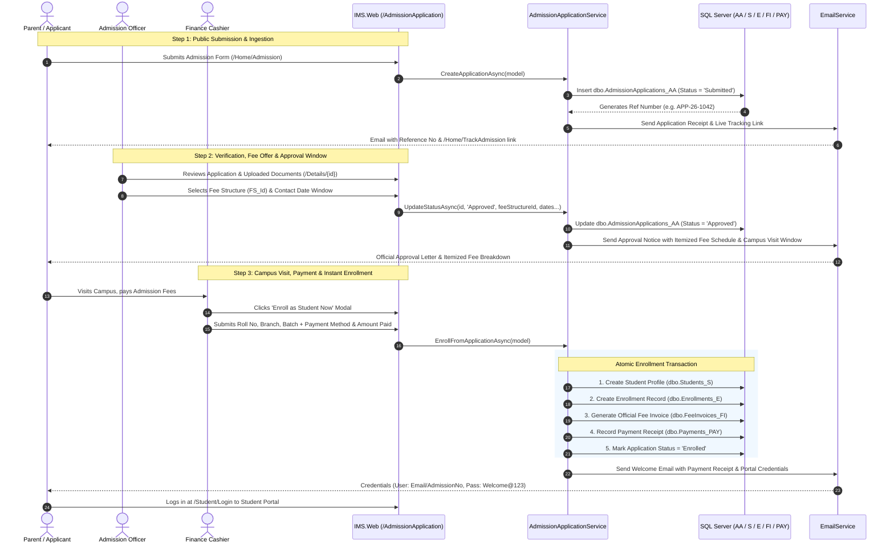

---

### 7.2 Flow 2: Academic Progression & Student Promotion

At the end of each academic year, students are formally transitioned into the next grade or section.

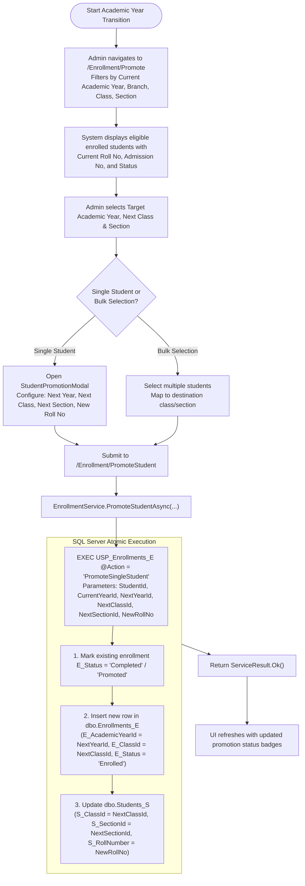

---

### 7.3 Flow 3: Curriculum Delivery, Batches & Timetables

Curriculum planning links courses, subjects, faculty allocations, and scheduling slots without room or instructor collisions.

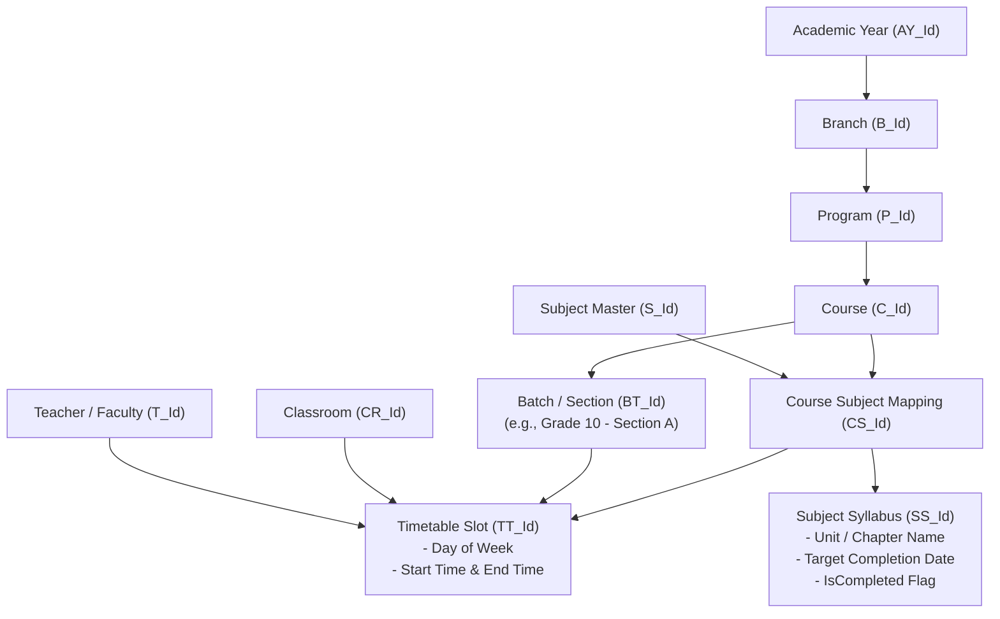

- **Clash Prevention:** The timetable engine validates that neither the assigned teacher nor the physical classroom is booked simultaneously in another batch for the same day and time slot.
- **Syllabus Tracking:** Teachers and admins log progress against syllabus units. Students track completion status in real-time on the student portal.

---

### 7.4 Flow 4: Daily Operations (Attendance & Leave Management)

Both students and faculty have dedicated daily operational tracks for attendance and leave approvals.

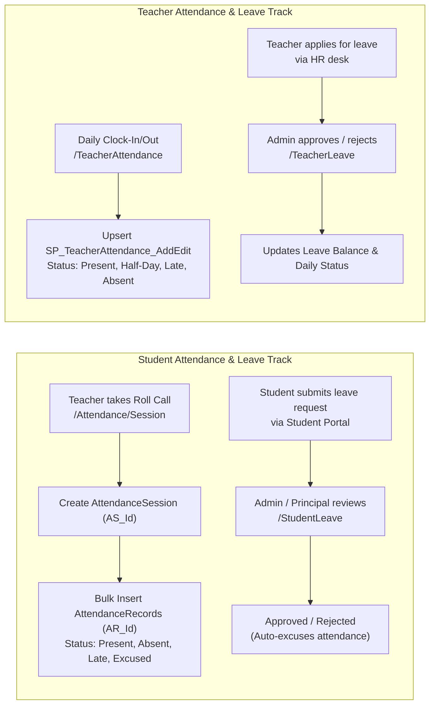

---

### 7.5 Flow 5: Examination Lifecycle, Grading & Digital Results

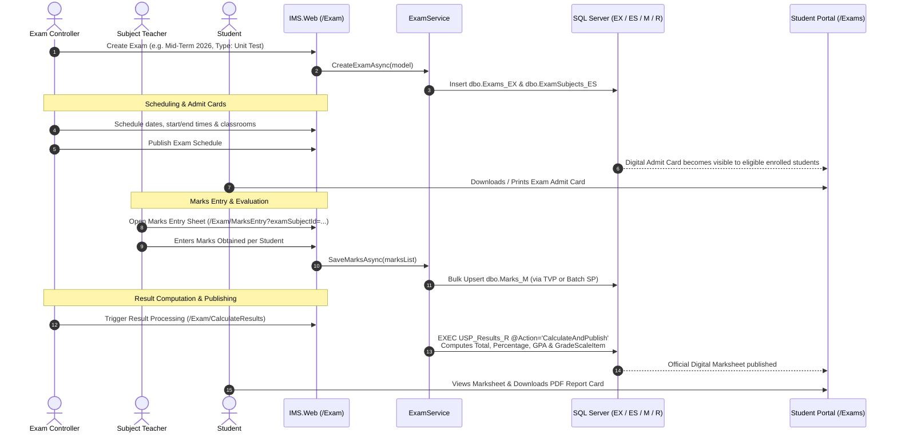

---

### 7.6 Flow 6: Institutional Finance & Fee Collection Engine

The financial engine manages the entire lifecycle from fee definition to real-time cash collection, ad-hoc billing, student ledgers, and audit-compliant daily scrolls.

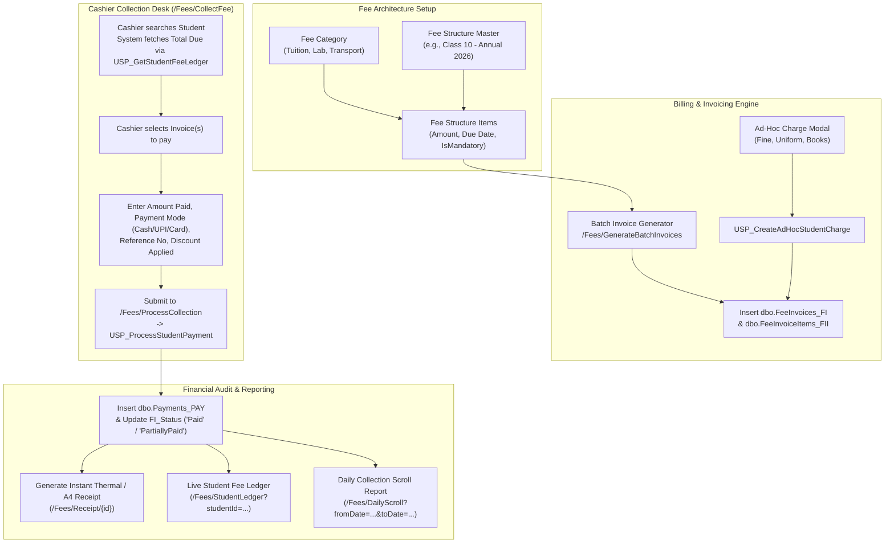

---

### 7.7 Flow 7: Student & Guardian Self-Service Portal

The student portal is a dedicated sub-application (`/StudentPortal`) running under the isolated cookie scheme `StudentPortalAuth`.

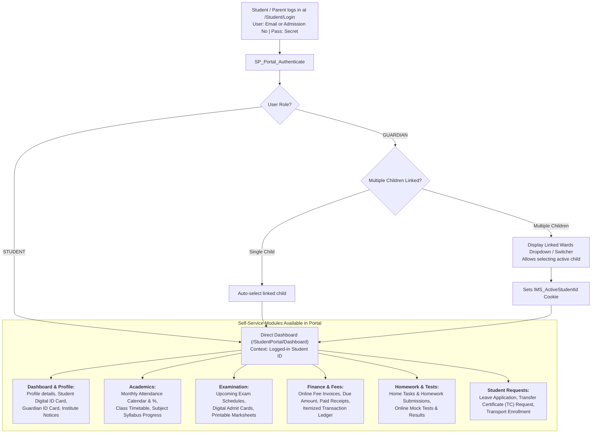

---

### 7.8 Flow 8: Metadata-Driven Master Data Engine (Zero-Code CRUD)

To eliminate repetitive boilerplate code for 15+ auxiliary configuration entities (Branches, Departments, Classrooms, Fee Categories, Grade Scales, etc.), ERP-IMS utilizes a dynamic metadata registry engine.

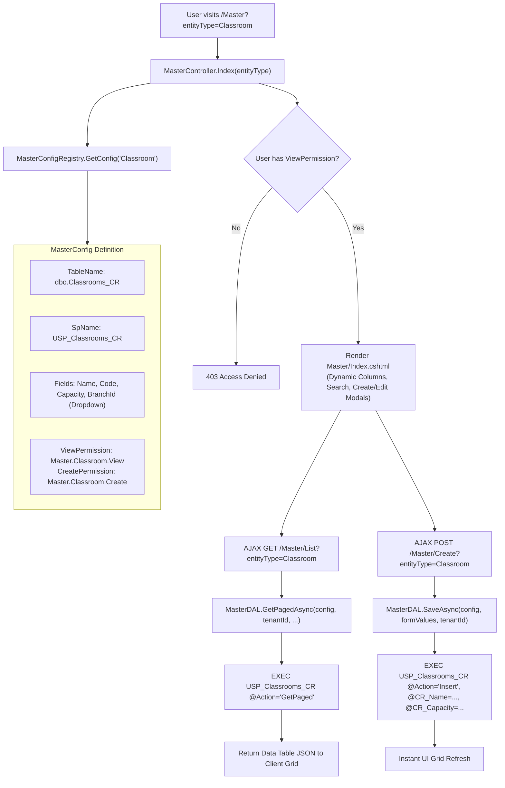

---

### 7.9 Flow 9: Dynamic Database-Driven Sidebar Navigation

Rather than hardcoding sidebar navigation links in Razor partials, the admin navigation is fully dynamic, stored in the database, cached in-memory, and filtered against each user's active permissions.

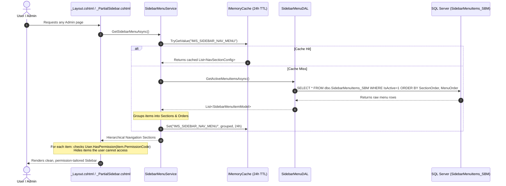

---

### 7.10 Flow 10: Institutional Data Backup & Notification Hub

- **Data Backup Engine (`DataBackupController` & `DataBackupService`):**
  - Allows administrators to preview and export full institutional datasets into structured CSV files.
  - Supports 13 core modules: Students, Applications, Enrollments, Teachers, Staff, Batches, Course Subjects, Timetables, Attendance, Fees, Expenses, Exams, and Master Data.
  - Automatically isolates exports by `TenantId` with optional date ranges, branches, and status filters.
- **Notification Hub (`NotificationConfigController` & `NotificationService`):**
  - Manages tenant-specific notification triggers (e.g., Admission Submitted, Application Approved, Fee Invoice Generated, Payment Received, Exam Published, Attendance Absent Alert).
  - Configures email delivery toggles, SMS gateways, in-app notifications, and custom email HTML templates.
  - Header bell icon displays unread notifications with mark-as-read functionality.

---

## 8. Complete Project & Directory Structure

```
d:\1Common\ExtraPush\IMS\erp-ims/
│
├── erp-ims.sln                             # Primary Visual Studio Solution file
├── systemArchitechture.md                  # This complete architecture document
├── README_ADMISSION_FLOW.md                # Admission Lifecycle & Payment guide
├── README_MENUS_HIERARCHY.md               # Menu navigation hierarchy specification
├── README_NAV_REDESIGN_BA.md               # Business analyst report on navigation UX
├── Dockerfile                              # Production container build manifest
├── docker-compose.yml                      # Production Docker orchestration
├── docker-compose.dev.yml                  # Local development orchestration (App + Redis + DB)
│
├── database/                               # Database assets & historical references
│   ├── ims_backup                          # Database backup directory
│   └── SYSTEM_ARCHITECTURE.md              # Historical database documentation (v1.0)
│
├── scripts/                                # PowerShell maintenance, migration & database scripts
│   ├── apply_admission_migration.ps1       # Script to execute admission schema updates
│   ├── apply_promotion_migration.ps1       # Script to configure student promotion SPs
│   ├── dump_master_datasets.ps1            # Utility to dump master lookup data
│   ├── test_dropdown.ps1                   # Stored procedure test harness for dropdowns
│   └── ...                                 # 40+ utility and inspection scripts
│
├── IMS.Helpers/                            # Cross-Cutting Constants & Shared Configuration
│   ├── IMS.Helpers.csproj                  # .NET 8 Class Library
│   ├── Constants/
│   │   ├── AppRoles.cs                     # System roles (TenantAdmin, SYSTEM_ADMIN, etc.)
│   │   ├── HardcodedMasterData.cs          # Development fallbacks & static GUID constants
│   │   ├── Permissions.cs                  # Complete RBAC permissions catalog & metadata
│   │   └── TeacherHrOptions.cs             # Teacher HR dropdown options (qualifications, blood groups)
│   └── Options/
│       └── ApiOptions.cs                   # Strongly-typed configuration for external User/System APIs
│
├── IMS.Models/                             # Shared Domain Entities, ViewModels & Registries
│   ├── IMS.Models.csproj                  # .NET 8 Class Library
│   ├── Academic/
│   │   ├── AcademicEntities.cs             # Core academic entities (Batch, Course, Subject, Timetable)
│   │   ├── BatchViewModels.cs              # Batch form and list view models
│   │   ├── CourseSubject.cs & ViewModels   # Curriculum mapping models
│   │   ├── Enrollment.cs & ViewModels      # Enrollment and Student Promotion view models
│   │   ├── Exam.cs & ExamViewModels.cs     # Exam, ExamSubject, Marks, and Result models
│   │   ├── Staff.cs & StaffViewModels.cs   # Staff profile and directory models
│   │   └── Timetable.cs & ViewModels.cs    # Timetable scheduling models
│   ├── Admission/
│   │   ├── AdmissionApplication.cs         # Admission application entity
│   │   └── AdmissionApplicationViewModels  # Public form, admin review, and fee offer models
│   ├── Announcement/
│   │   └── Announcement.cs & ViewModels    # Campus announcements and broadcast notices
│   ├── Auth/
│   │   └── UserProfileModel.cs             # Keycloak user profile DTO
│   ├── Backup/
│   │   └── DataBackupViewModels.cs         # Institutional data backup and export models
│   ├── Common/
│   │   ├── ApiResponseModel.cs             # Standardized AJAX API response envelope
│   │   ├── Dropdown/
│   │   │   ├── DropdownConfig.cs           # Configuration schema for generic dropdowns
│   │   │   ├── DropdownConfigRegistry.cs   # Central registry for generic dropdown types
│   │   │   └── DropdownItemModel.cs        # Generic Value/Text DTO
│   │   ├── Master/
│   │   │   ├── BaseMasterModel.cs          # Base model for master lookup tables
│   │   │   ├── MasterConfig.cs             # Metadata definition for zero-code master CRUD
│   │   │   └── MasterConfigRegistry.cs     # Central registry of 15+ master lookup entities
│   │   └── Navigation/
│   │       └── SidebarNavConfig.cs         # Models for database-driven dynamic sidebar navigation
│   ├── Finance/
│   │   ├── Expense.cs & ViewModels.cs      # Institutional expense and category models
│   │   ├── FeeEntities.cs                  # FeeStructure, FeeInvoice, Payment, Refund entities
│   │   └── FeeViewModels.cs                # Fee collection desk, ledger, batch invoice models
│   ├── HomeTask/
│   │   └── HomeTaskModels.cs               # Homework assignments and submissions
│   ├── MockTest/
│   │   └── MockTestModels.cs               # Online mock tests, questions, and scores
│   ├── Notification/
│   │   └── NotificationModels.cs           # Notification config, events, and templates
│   ├── Portal/
│   │   └── PortalViewModels.cs             # Specialized DTOs for the Student & Guardian Portal
│   ├── Session/
│   │   └── UserSessionModel.cs             # Redis session cache model
│   ├── Student/
│   │   ├── Student.cs & ViewModels.cs      # Student profiles, quick update, and search models
│   │   └── Guardian.cs & ViewModels.cs     # Guardian profiles and student linkage models
│   ├── SubjectSyllabus/
│   │   └── SubjectSyllabus.cs & ViewModels # Term-wise syllabus units and progress tracking
│   ├── Teacher/
│   │   ├── Teacher.cs & ViewModels.cs      # Faculty directory and profile models
│   │   ├── TeacherAttendance.cs & Models   # Daily teacher attendance tracking models
│   │   └── TeacherLeave.cs & Models        # Teacher leave application and review models
│   └── TenantUser/
│       └── TenantUserModels.cs             # User management and profile models
│
├── IMS.DAL/                                # Data Access Layer (Raw ADO.NET & Stored Procedures)
│   ├── IMS.DAL.csproj                      # .NET 8 Class Library
│   ├── Common/
│   │   ├── DBHelper.cs                     # ADO.NET wrapper (connection pooling, TVP, execution)
│   │   ├── DropdownDAL.cs                  # Generic cascading dropdown stored procedure caller
│   │   └── MasterDAL.cs                    # Generic master CRUD stored procedure caller
│   ├── Interfaces/                         # 30+ Data Access Interfaces
│   │   ├── IStudentDAL.cs, IEnrollmentDAL.cs, IFeeDAL.cs, IExamDAL.cs, etc.
│   └── Repositories/                       # 30+ Concrete DAL implementations
│       ├── AdmissionApplicationDAL.cs      # Admission application procedures
│       ├── AttendanceDAL.cs                # Session and student record procedures
│       ├── BatchDAL.cs                     # Batch CRUD procedures
│       ├── CourseSubjectDAL.cs             # Curriculum mapping procedures
│       ├── DataBackupDAL.cs                # Institutional data extraction queries
│       ├── EnrollmentDAL.cs                # Enrollment and student promotion procedures
│       ├── ExamDAL.cs                      # Exam, ExamSubject, Marks, Result procedures
│       ├── ExpenseDAL.cs & ExpenseCategory # Expense logging procedures
│       ├── FeeDAL.cs                       # FeeStructures, Invoices, Payments, Ledgers, Scrolls
│       ├── GuardianDAL.cs                  # Guardian CRUD and lookup procedures
│       ├── HomeTaskDAL.cs                  # Homework assignment procedures
│       ├── MockTestDAL.cs                  # Mock test procedures
│       ├── NotificationDAL.cs & Config     # In-app notifications & hub config
│       ├── SidebarMenuDAL.cs               # Database-driven sidebar menu queries
│       ├── StaffDAL.cs                     # Staff directory procedures
│       ├── StudentDAL.cs                   # Student CRUD, quick update, search procedures
│       ├── StudentLeaveDAL.cs              # Student leave review procedures
│       ├── StudentPortalDAL.cs             # 25+ Student portal specialized procedures
│       ├── SubjectSyllabusDAL.cs           # Syllabus progress tracking procedures
│       ├── TeacherDAL.cs                   # Teacher profiles procedures
│       ├── TeacherAttendanceDAL.cs         # Teacher daily attendance procedures
│       ├── TeacherLeaveDAL.cs              # Teacher leave workflow procedures
│       ├── TimetableDAL.cs                 # Timetable scheduling procedures
│       └── TransferCertificateDAL.cs       # Transfer certificate review procedures
│
├── IMS.Services/                           # Business Logic & Orchestration Layer
│   ├── IMS.Services.csproj                 # .NET 8 Class Library
│   ├── Interfaces/                         # 30+ Domain Service Interfaces
│   ├── AdmissionApplicationService.cs      # Admission review, fee offer, and enrollment logic
│   ├── AttendanceService.cs                # Student session attendance orchestration
│   ├── BatchService.cs                     # Batch lifecycle and capacity validation
│   ├── CourseSubjectService.cs             # Curriculum allocation rules
│   ├── EmailService.cs                     # HTML email template formatting and SMTP sending
│   ├── EnrollmentService.cs                # Student enrollment and grade promotion engine
│   ├── ExamService.cs                      # Examination scheduling, marks entry, and GPA math
│   ├── ExpenseService.cs                   # Expense tracking and category budgeting
│   ├── FeeService.cs                       # Billing engine, counter collection, student ledgers
│   ├── GuardianService.cs                  # Guardian-student association rules
│   ├── HomeTaskService.cs                  # Homework assignment and submission validation
│   ├── MockTestService.cs                  # Online mock test evaluation
│   ├── NotificationService.cs              # Notification triggering and event dispatch
│   ├── PermissionSyncService.cs            # Pushes internal permissions to central IAM API
│   ├── RedisService.cs                     # Redis caching wrapper for sessions and permissions
│   ├── RoleApiService.cs                   # External System API client for role permissions
│   ├── SidebarMenuService.cs               # Navigation caching and permission filtering
│   ├── StaffService.cs                     # Staff administrative operations
│   ├── StudentPortalService.cs             # Student portal authentication, wards, and requests
│   ├── StudentLeaveService.cs              # Student leave review workflows
│   ├── StudentService.cs                   # Student profiles, quick edits, status updates
│   ├── SubjectSyllabusService.cs           # Syllabus milestone tracking
│   ├── TeacherAttendanceService.cs         # Faculty clock-in/out logic
│   ├── TeacherLeaveService.cs              # Teacher leave allocation and approvals
│   ├── TeacherService.cs                   # Teacher profile management
│   ├── TimetableService.cs                 # Timetable scheduling and conflict validation
│   ├── TransferCertificateService.cs       # TC issuance, verification, and clearance
│   ├── UserApiService.cs                   # External User API client (/users/my-profile)
│   ├── UserSessionService.cs               # OpenID Connect claims enrichment and Redis session
│   └── Backup/
│       └── DataBackupService.cs            # Data export orchestration and CSV serialization
│
└── IMS.Web/                                # Presentation Layer (ASP.NET Core 8.0 MVC)
    ├── IMS.Web.csproj                      # Web Project File
    ├── Program.cs                          # Application bootstrapper and DI configuration
    ├── appsettings.json                    # Configuration (ConnectionStrings, Keycloak, Redis, APIs)
    │
    ├── Areas/                              # MVC Areas
    │   └── StudentPortal/                  # Self-Service Student & Guardian Portal Area
    │       ├── Controllers/
    │       │   ├── StudentPortalBaseController.cs # Base controller (claims, active student context)
    │       │   ├── AuthController.cs              # Portal login, logout, password reset
    │       │   ├── DashboardController.cs         # Portal overview, digital ID cards, notices
    │       │   ├── AcademicsController.cs         # Attendance, timetable, class, syllabus
    │       │   ├── ExamsController.cs             # Admit cards, marksheet viewer
    │       │   ├── FinanceController.cs           # Fee invoices, payments, receipts
    │       │   ├── RequestsController.cs          # Leave application, TC request, transport
    │       │   └── TasksController.cs             # Homework and online mock tests
    │       └── Views/
    │           ├── Shared/_StudentPortalLayout.cshtml # Dedicated Student Portal Layout
    │           ├── Auth/                          # Login and password recovery views
    │           ├── Dashboard/                     # Portal dashboard and ID card templates
    │           ├── Academics/                     # Attendance, syllabus, and timetable views
    │           ├── Exams/                         # Admit cards and marksheet templates
    │           ├── Finance/                       # Payment receipts and transaction ledgers
    │           ├── Requests/                      # Leave and TC application forms
    │           └── Tasks/                         # Homework submission and mock test views
    │
    ├── Authorization/                      # Dynamic Permission Authorization System
    │   ├── PermissionAttribute.cs          # [Permission("...")] declarative action attribute
    │   ├── PermissionRequirement.cs        # IAuthorizationRequirement implementation
    │   ├── PermissionPolicyProvider.cs     # Dynamic policy generator
    │   ├── PermissionAuthorizationHandler.cs # Multi-level handler (Bypass, Cache, Fallback)
    │   └── PermissionCheckTagHelper.cs     # <permission-check name="..."> Razor tag helper
    │
    ├── Controllers/                        # 27 Admin MVC Controllers
    │   ├── HomeController.cs               # Dashboard, Admission Form, TrackAdmission
    │   ├── StudentsController.cs           # Student directory, CRUD, quick updates
    │   ├── AdmissionApplicationController.cs # Admission review, verification, fee offer
    │   ├── EnrollmentController.cs         # Batch allocation, student promotion
    │   ├── FeesController.cs               # Billing, collection desk, ledgers, daily scroll
    │   ├── ExamController.cs               # Exams, schedules, marks entry, report cards
    │   ├── TimetableController.cs          # Timetable scheduling grids
    │   ├── BatchController.cs              # Batch management
    │   ├── CourseSubjectController.cs      # Curriculum mapping
    │   ├── SyllabusController.cs           # Term syllabus progress tracking
    │   ├── AttendanceController.cs         # Daily student roll call and sessions
    │   ├── MasterController.cs             # Generic metadata-driven CRUD engine
    │   ├── DropdownController.cs           # Generic cascading dropdown endpoints
    │   ├── SidebarMenuController.cs        # UI sidebar navigation management
    │   ├── TeachersController.cs           # Faculty directory
    │   ├── TeacherAttendanceController.cs  # Faculty daily attendance
    │   ├── TeacherLeaveController.cs       # Faculty leave approvals
    │   ├── StudentLeaveController.cs       # Student leave approvals
    │   ├── TransferCertificateController.cs# Student TC issuance and clearance
    │   ├── HomeTasksController.cs          # Homework assignments
    │   ├── MockTestsController.cs          # Mock tests and assessments
    │   ├── AnnouncementsController.cs      # Campus notice board
    │   ├── NotificationConfigController.cs # Notification hub and email settings
    │   ├── DataBackupController.cs         # Institutional data backup and CSV exporter
    │   ├── StaffController.cs              # Administrative staff directory
    │   └── TenantUserProfileController.cs  # Tenant user profile and password settings
    │
    ├── Extensions/                         # Dependency Injection Service Registrars
    │   ├── KeycloakExtensions.cs           # Keycloak OIDC, cookies, silent token refresh
    │   ├── AuthorizationExtensions.cs      # Dynamic permission authorization DI
    │   ├── DALServiceExtensions.cs         # Scoped registration for DBHelper and 30+ DALs
    │   └── ServiceLayerExtensions.cs       # Scoped registration for 30+ Business Services
    │
    ├── HostedServices/                     # Background Hosted Services
    │   └── PermissionSyncStartupService.cs # Startup permission sync to central IAM API
    │
    ├── Views/                              # Admin Razor Views (27 Feature Folders)
    │   ├── Shared/
    │   │   ├── _Layout.cshtml              # Master administrative layout
    │   │   ├── _PartialSidebar.cshtml      # Dynamic database-driven sidebar partial
    │   │   ├── _PartialNavbar.cshtml       # Top header bar (profile, notifications)
    │   │   └── _ValidationScriptsPartial   # Client validation bundle
    │   ├── AdmissionApplication/           # Ingestion, review desk, enrollment modals
    │   ├── Enrollment/                     # Enrollment list, Student Promotion views
    │   ├── Fees/                           # Invoices, CollectFee, Ledger, DailyScroll, Receipt
    │   ├── Students/                       # Directory, Create, Edit, Details, Quick-edit
    │   ├── Master/                         # Dynamic generic master view template
    │   ├── SidebarMenu/                    # Drag-and-drop menu management
    │   └── ...                             # Remaining module view templates
    │
    └── wwwroot/                            # Static Web Assets
        ├── css/                            # Custom styling, dark/light theme, layout CSS
        ├── js/                             # Module-specific JavaScript (students.js, fees.js)
        ├── lib/                            # Vendor libraries (Bootstrap 5, FontAwesome, jQuery)
        └── uploads/                        # Uploaded admission documents, photos, certificates
```

---

## 9. Database Architecture & Design Patterns

### 9.1 Table Naming & Suffix Standards

To maintain absolute clarity across 40+ tables and eliminate column ambiguity in SQL joins, every table uses a distinctive **2 to 3 letter uppercase suffix**:

| Table Name | Suffix | Primary Key | Tenant Column | Soft Delete Column / Logic |
|---|---|---|---|---|
| `AcademicYears_AY` | `AY` | `AY_Id` | `AY_TenantId` | Hard delete / Status-based |
| `Branches_B` | `B` | `B_Id` | `B_TenantId` | Hard delete |
| `Departments_D` | `D` | `D_Id` | `D_TenantId` | Hard delete |
| `Classrooms_CR` | `CR` | `CR_Id` | `CR_TenantId` | Status-based (`CR_IsActive`) |
| `Programs_P` | `P` | `P_Id` | `P_TenantId` | Hard delete |
| `Courses_C` | `C` | `C_Id` | `C_TenantId` | Hard delete |
| `Subjects_S` | `S` | `S_Id` | `S_TenantId` | Hard delete |
| `Batches_BT` | `BT` | `BT_Id` | `BT_TenantId` | Hard delete / Status |
| `CourseSubjects_CS` | `CS` | `CS_Id` | `CS_TenantId` | Hard delete |
| `SubjectSyllabus_SS` | `SS` | `SS_Id` | `SS_TenantId` | `SS_IsActive` |
| `Timetables_TT` | `TT` | `TT_Id` | `TT_TenantId` | Hard delete |
| `Students_S` | `S` | `S_Id` | `S_TenantId` | `S_DeletedAt` (Soft delete) + `S_Status` |
| `Guardians_G` | `G` | `G_Id` | `G_TenantId` | `G_DeletedAt` (Soft delete) |
| `Students_Guardians` | `SG` | `SG_Id` | Via Student Link | Hard delete |
| `AdmissionApplications_AA`| `AA` | `AA_Id` | `AA_TenantId` | Status: `Submitted`, `Approved`, `Enrolled` |
| `Enrollments_E` | `E` | `E_Id` | `E_TenantId` | Status: `Enrolled`, `Promoted`, `Transferred` |
| `Staff_ST` | `ST` | `ST_Id` | `ST_TenantId` | `ST_DeletedAt` + `ST_Status` |
| `Teachers_T` | `T` | `T_Id` | `T_TenantId` | `T_IsDeleted` / `T_IsActive` |
| `TeacherAttendance_TA`| `TA` | `TA_Id` | `TA_TenantId` | Daily log |
| `TeacherLeaves_TL` | `TL` | `TL_Id` | `TL_TenantId` | Status: `Pending`, `Approved`, `Rejected` |
| `StudentLeaves_SL` | `SL` | `SL_Id` | `SL_TenantId` | Status: `Pending`, `Approved`, `Rejected` |
| `TransferCertificates_TC`| `TC` | `TC_Id` | `TC_TenantId` | Status: `Requested`, `Issued`, `Rejected` |
| `AttendanceSessions_AS` | `AS` | `AS_Id` | `AS_TenantId` | Session header |
| `AttendanceRecords_AR` | `AR` | `AR_Id` | Via Session | Status: `Present`, `Absent`, `Late`, `Excused` |
| `FeeCategories_FC` | `FC` | `FC_Id` | `FC_TenantId` | Hard delete |
| `FeeStructures_FS` | `FS` | `FS_Id` | `FS_TenantId` | `FS_IsActive` |
| `FeeStructureItems_FSI` | `FSI` | `FSI_Id` | Via FeeStructure | Hard delete |
| `FeeInvoices_FI` | `FI` | `FI_Id` | `FI_TenantId` | Status: `Unpaid`, `PartiallyPaid`, `Paid`, `Cancelled` |
| `FeeInvoiceItems_FII` | `FII` | `FII_Id` | Via FeeInvoice | Hard delete |
| `Payments_PAY` | `PAY` | `PAY_Id` | `PAY_TenantId` | Status: `Success`, `Refunded`, `Cancelled` |
| `Expenses_EXP` | `EXP` | `EXP_Id` | `EXP_TenantId` | Hard delete |
| `Exams_EX` | `EX` | `EX_Id` | `EX_TenantId` | Status: `Draft`, `Scheduled`, `Completed`, `Published` |
| `ExamSubjects_ES` | `ES` | `ES_Id` | Via Exam | Hard delete |
| `Marks_M` | `M` | `M_Id` | Via ExamSubject | Hard delete |
| `Results_R` | `R` | `R_Id` | Via Exam | Status: `Calculated`, `Published` |
| `HomeTasks_HT` | `HT` | `HT_Id` | `HT_TenantId` | `HT_IsActive` |
| `MockTests_MT` | `MT` | `MT_Id` | `MT_TenantId` | `MT_IsActive` |
| `SidebarMenuItems_SBM` | `SBM` | `Id` (INT) | Shared / Config | `IsActive` |

---

### 9.2 Common Columns & Audit Tracking

All primary business entities feature consistent column definitions:
- `[Prefix]_Id`: `UNIQUEIDENTIFIER` with `DEFAULT NEWSEQUENTIALID()`.
- `[Prefix]_TenantId`: `UNIQUEIDENTIFIER NOT NULL`.
- `[Prefix]_CreatedAt`: `DATETIME2 NOT NULL DEFAULT GETUTCDATE()`.
- `[Prefix]_CreatedBy`: `NVARCHAR(100)` or `UNIQUEIDENTIFIER`.
- `[Prefix]_ModifiedAt`: `DATETIME2 NULL`.
- `[Prefix]_ModifiedBy`: `NVARCHAR(100)` or `UNIQUEIDENTIFIER NULL`.
- `[Prefix]_DeletedAt`: `DATETIME2 NULL` (for soft-deleted records like Students and Staff).

---

### 9.3 Stored Procedure Patterns & Action Verbs

The application follows a standard stored procedure routing pattern. Procedures for master entities and complex modules utilize an `@Action` parameter to group related operations:

```sql
CREATE PROCEDURE [dbo].[USP_Classrooms_CR]
    @Action NVARCHAR(20),
    @CR_Id UNIQUEIDENTIFIER = NULL,
    @CR_TenantId UNIQUEIDENTIFIER,
    @CR_Name NVARCHAR(100) = NULL,
    @CR_Capacity INT = NULL,
    @SearchTerm NVARCHAR(255) = NULL,
    @PageNumber INT = 1,
    @PageSize INT = 10,
    @NewId UNIQUEIDENTIFIER OUTPUT
AS
BEGIN
    SET NOCOUNT ON;

    IF @Action = 'GetById'
    BEGIN
        SELECT * FROM dbo.Classrooms_CR
        WHERE CR_Id = @CR_Id AND CR_TenantId = @CR_TenantId;
    END
    ELSE IF @Action = 'GetPaged'
    BEGIN
        -- Query 1: Total Count
        SELECT COUNT(1) AS TotalCount FROM dbo.Classrooms_CR
        WHERE CR_TenantId = @CR_TenantId
          AND (@SearchTerm IS NULL OR CR_Name LIKE '%' + @SearchTerm + '%');

        -- Query 2: Paged Result Set
        SELECT * FROM dbo.Classrooms_CR
        WHERE CR_TenantId = @CR_TenantId
          AND (@SearchTerm IS NULL OR CR_Name LIKE '%' + @SearchTerm + '%')
        ORDER BY CR_Name
        OFFSET (@PageNumber - 1) * @PageSize ROWS
        FETCH NEXT @PageSize ROWS ONLY;
    END
    ELSE IF @Action = 'Insert'
    BEGIN
        SET @NewId = NEWID();
        INSERT INTO dbo.Classrooms_CR (CR_Id, CR_TenantId, CR_Name, CR_Capacity, CR_CreatedAt)
        VALUES (@NewId, @CR_TenantId, @CR_Name, @CR_Capacity, GETUTCDATE());
    END
    -- Additional actions: 'Update', 'Delete', 'ExistsByField'
END
```

---

### 9.4 Table-Valued Parameters (TVPs) & Transactions

For high-volume bulk operations (such as saving classroom attendance for 60 students or entering exam marks for an entire cohort), ERP-IMS avoids individual iterative SQL calls. Instead, it utilizes SQL Server **Table-Valued Parameters (TVPs)**:

1. A user-defined table type is defined in SQL Server (e.g. `AttendanceRecordTableType`).
2. `DBHelper.TableParam` binds an in-memory C# `DataTable` to `SqlParameter` with `SqlDbType.Structured`.
3. The stored procedure performs a high-speed `MERGE` or batch `INSERT` within an explicit SQL transaction:

```sql
CREATE TYPE [dbo].[AttendanceRecordTableType] AS TABLE
(
    StudentId UNIQUEIDENTIFIER,
    Status NVARCHAR(20),
    Remarks NVARCHAR(255)
);
```

---

## 10. Architectural Highlights & Best Practices

1. **Zero-ORM Raw ADO.NET Performance:**
   - By eliminating Entity Framework Core in favor of compiled Stored Procedures and `SqlDataReader`, ERP-IMS achieves sub-5ms query executions, zero runtime query generation overhead, and precise control over execution plans and lock escalations.
2. **Metadata-Driven Rapid Application Development:**
   - The `MasterConfigRegistry` pattern allows adding new institutional lookup entities in under 15 minutes by writing a single configuration entry, completely avoiding repetitive controller, view, or DTO coding.
3. **High Availability Identity & Resilient Token Management:**
   - Keycloak integration features automatic background refresh token exchange (`TryRefreshTokenAsync`), preventing sudden user session dropouts during administrative tasks.
4. **Three-Tier Permission Resolution Hierarchy:**
   - Action authorization checks are evaluated through a high-speed pipeline: (1) Instant admin bypass, (2) In-request `HttpContext.Items` cache, (3) Redis distributed cache (1h TTL), and (4) External Role API fallback.
5. **Decoupled Student Self-Service Area:**
   - The Student Portal is physically segregated in `IMS.Web/Areas/StudentPortal` with its own authentication cookie, view models, and styling. This guarantees that student-facing traffic cannot access administrative endpoints or compromise staff sessions.
6. **Parent Multi-Ward Support:**
   - Guardians with multiple children in the same institution can switch active student contexts seamlessly via encrypted session cookies without re-authenticating.
7. **End-to-End Audit & Financial Integrity:**
   - Every invoice, ad-hoc charge, collection receipt, and refund is strictly tracked in the institutional ledger with tenant scoping, user audit trails, and daily collection scroll reporting.

---

*End of Architecture Document. For questions or modifications regarding specific modules, refer to the corresponding controller, service, or repository files.*

